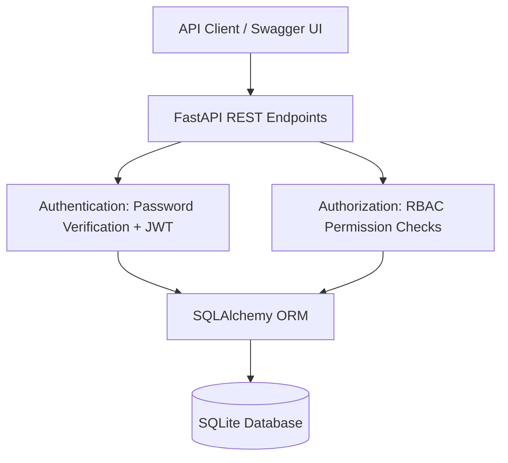

# NorthStar Enterprise Identity & Security Lab

## Quick Start

### Requirements
- Python 3.10+
- Git

### Run locally

```bash
git clone https://github.com/Dero-Tech/enterprise-security-lab.git
cd enterprise-security-lab/identity-platform

python3 -m venv .venv
source .venv/bin/activate
python -m pip install -r requirements.txt

python -m uvicorn app.main:app --reload
```

### API Documentation

After starting the server, visit:

http://127.0.0.1:8000/docs

### Health Check

GET http://127.0.0.1:8000/health

Expected response:

```json
{"status": "healthy"}
```

This is a local development demonstration,
not a production deployment.


Enterprise-inspired Identity and Access Management platform built with FastAPI, SQLAlchemy, and Python.

## Current Features

NorthStar IAM is an enterprise-inspired identity and access management API built for a fictional healthcare organization.

### Implemented functionality
- REST API developed with Python and FastAPI
- SQLAlchemy ORM and SQLite database persistence
- Pydantic request validation
- Password hashing and password verification
- JWT-based login authentication
- Protected user identity endpoint
- Role-based access control for user-management endpoints
- Duplicate user detection
- Interactive OpenAPI documentation through Swagger UI

### Manually verified API behavior

| Test scenario | Expected HTTP status | Observed |
|---|---|---|
| Unauthenticated identity request | 401 | 401 |
| Unauthenticated user listing | 401 | 401 |
| Invalid email input | 422 | 422 |
| Invalid login credentials | 401 | 401 |
| Valid JWT accessing own identity | 200 | 200 |
| Regular user accessing restricted user list | 403 | 403 |
| Authorized administrator accessing user list | 200 | 200 |

These results were obtained through manual local testing. Automated regression testing and broader security review remain in progress.

### Security design
The application separates authentication from authorization. JWTs establish the requesting user's identity, while permission checks determine which operations that identity may perform.

## System Architecture



The application separates authentication from authorization. JWT authentication identifies users, while role-based permission checks determine which operations they can perform. SQLAlchemy manages database access.

## RBAC Security Testing Evidence

The following screenshot demonstrates an authenticated
user attempting to access a protected user-management
endpoint without the required `users:view` permission.

The application returned HTTP 403 Forbidden, confirming
that the request was denied by the RBAC permission check.


An authorized administrator was separately verified
to receive HTTP 200 for the same endpoint.

**Testing status:** Manually verified using FastAPI
Swagger UI with fictional test accounts.

  ### Planned improvements
- Automated authentication and RBAC testing
- Audit logging
- Identity lifecycle management
- Additional token-expiration and invalid-signature tests
- Broader production security hardening

### Project scope
This is an educational portfolio application using fictional healthcare organization data. It is not a production identity management service.
